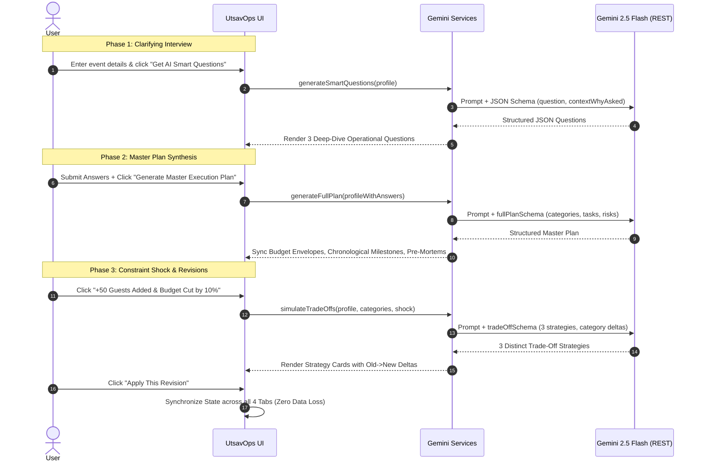

# UtsavOps AI — Celebration & Event Operations Engine
> **PromptWars Challenge 5: Celebration & Event Planner**  
> Built with **React 19**, **TypeScript**, **Vite**, **Tailwind CSS v4**, and **Gemini 2.5 Flash**.

---

## 🌟 Executive Summary & Problem Statement Alignment

Organizing large-scale Indian celebrations (Weddings, Milestone Anniversaries, Corporate Galas, Community Utsavs) is fundamentally an exercise in **high-stakes real-time operations under volatility**. Planners face four chronic points of failure:

1. **Rigid Budgeting vs. Real-Life Constraint Shocks**: Spreadsheets break when 50 unannounced guests RSVP or budgets are slashed by 10%. Generic tools start from scratch; **UtsavOps AI dynamically reallocates funds** while fiercely shielding the user's #1 non-negotiable priority (e.g., Catering & Food).
2. **Invisible Critical Path Dependencies**: Vendors operate sequentially. If a venue booking is delayed by 7 days, caterers cannot measure kitchens and decorator teams stall. UtsavOps visualizes **topological blockers** (`Blocked by: [Book Venue]`) and provides an **AI Domino Recovery Engine** to recalculate compressed deadlines.
3. **Messy & Deceptive Vendor Quotations**: Indian vendor quotes arrive as messy WhatsApp estimates riddled with sneaky exclusions (e.g., *"18% GST extra"*, *"Generator diesel surcharge ₹8,000"*, *"Staff overtime beyond 11:30 PM"*). UtsavOps extracts normalized unit costs, unmasks hidden taxes, and auto-generates **4 tough WhatsApp negotiation questions**.
4. **Anti-Hallucination Governance**: Distinguishes unverified AI guestimates from verified vendor quotes with 1-click verification toggles, ensuring financial accountability.

---

## 🏛 Architecture Diagram & System Design

```mermaid
graph TD
    User([User / Event Planner]) --> Shell[App Shell & HeaderNav]
    Shell --> Tab1[Tab 1: Discovery & Setup]
    Shell --> Tab2[Tab 2: Budget & Crisis Simulator]
    Shell --> Tab3[Tab 3: Dependency Timeline]
    Shell --> Tab4[Tab 4: Vendor Quote Analyzer]
    
    subgraph UI_Components [Modular UI Tier]
        Tab1 --> Intake[EventIntakeForm]
        Tab1 --> Ranker[PriorityRanker]
        Tab1 --> SmartQ[SmartQuestionsStep]
        
        Tab2 --> ShockPanel[ConstraintShockPanel]
        Tab2 --> StratCards[TradeOffStrategyCards]
        Tab2 --> Charts[BudgetOverviewCharts - Recharts]
        Tab2 --> CatTable[CategoryBreakdownTable]
        
        Tab3 --> Toolbar[TimelineToolbar]
        Tab3 --> TaskList[TaskCard - Visual Blockers]
        Tab3 --> DelayModal[DelaySimulationModal]
        
        Tab4 --> QuoteTabs[QuoteInputTabs - Sample Loader]
        Tab4 --> CompareCard[QuoteComparisonCard]
    end

    subgraph Deterministic_Tier [Deterministic Math & State Engine]
        BudgetLogic[src/utils/budgetLogic.ts]
        BudgetLogic --> MathCheck[Total / Variance / Per-Guest Math]
        BudgetLogic --> DepCheck[Topological Dependency Resolver]
        StateStore[Unified React State - Zero Data Loss Sync]
    end

    subgraph AI_Tier [Gemini 2.5 Flash REST Client]
        GeminiClient[src/services/geminiClient.ts]
        PlanService[src/services/planService.ts]
        TradeoffService[src/services/tradeoffService.ts]
        QuoteService[src/services/quoteService.ts]
    end

    UI_Components --> BudgetLogic
    UI_Components --> StateStore
    UI_Components --> GeminiClient
    GeminiClient --> PlanService
    GeminiClient --> TradeoffService
    GeminiClient --> QuoteService
    GeminiClient -.-> GeminiAPI[(Google Gemini 2.5 Flash API)]
```



---

## 🔄 AI Prompt Flow & Structured Schemas



---

## ⚖️ Division of Labor: GenAI vs. Deterministic Logic

| Responsibility | Handled By | Rationale |
| :--- | :--- | :--- |
| **Topological Blocked Badges** | **Deterministic Logic** (`src/utils/budgetLogic.ts`) | Strict graph resolution ensures downstream tasks are never falsely unlocked until parent IDs reach `status === 'completed'`. |
| **Budget Variance & Per-Head Math** | **Deterministic Logic** (`calculateBudgetVariance`) | Prevents floating-point rounding errors and LLM calculation hallucination. |
| **Date Arithmetic & Milestones Shifts** | **Deterministic Logic** (`Date.getTime() + delta`) | Guaranteed non-drift calendar day shifts without hallucinating invalid dates. |
| **State Synchronization across Tabs** | **React 19 State** | Single source of truth; applying a revision instantly updates Header pills, Recharts, and task lists without wiping data. |
| **Smart Clarifying Questions** | **Gemini 2.5 Flash** (`planService.ts`) | Natural language synthesis to formulate hyper-contextual questions based on guest age mix and atmosphere. |
| **Trade-Off Formulation** | **Gemini 2.5 Flash** (`tradeoffService.ts`) | Contextual reasoning that honors user's ranked priorities (shielding #1 priority while trimming flexible line items). |
| **Vendor Quote OCR & Hidden Levy Audit** | **Gemini 2.5 Flash** (`quoteService.ts`) | Parses unstructured, messy WhatsApp chats to unmask hidden GST, generator fuel, and overtime penalties. |
| **Tough WhatsApp Negotiation Scripts** | **Gemini 2.5 Flash** (`quoteService.ts`) | Crafts professional, culturally attuned, assertive negotiation prompts ready for WhatsApp copy-pasting. |

---

## 📦 Core Feature Modules

### 🎯 Tab 1: Discovery & Setup
- **Multi-Occasion Intake**: Fast presets for Weddings, Birthdays, Cultural/Community Events, and Corporate Galas.
- **Atmosphere Selector**: Visual selection across *Intimate*, *Balanced*, and *Grand* celebrations.
- **Priority Ranker**: Drag-and-drop / Move Up & Down reordering of core pillars (Food & Catering, Venue, Decor, Photography, Entertainment).
- **AI Clarifying Questions**: Formulates 3 operational questions (e.g. monsoon backup, Jain counters, senior-citizen wheelchair ramps) before finalizing the plan.

### 💰 Tab 2: Budget & Crisis Simulator
- **Constraint Shock & Revision Panel**: Instant test triggers for judges:
  - **Button A**: `+50 Guests Added & Budget Cut by 10%`
  - **Button B**: `Expenses Exceeded Budget by 20% (₹8L -> ₹9.6L)`
  - **Button C**: `Event Moved 2 Weeks Earlier`
  - **Custom Prompt**: Type any natural language scenario.
- **3 Distinct Trade-Off Strategies**:
  1. *Priority-Shielding*: 100% protection for the #1 ranked category.
  2. *Per-Unit Optimization*: Live counters and per-plate menu re-engineering.
  3. *Hybrid Harmony*: Balanced, proportional trims across all discretionary vendors.
- **Anti-Hallucination Governance**: One-click toggles between `AI Estimate (Unverified)` and `Confirmed Vendor Quote`.
- **Recharts Data Visualizations**: Donut allocation chart and comparative Allocated vs. Actual Bar chart.

### 📅 Tab 3: Dependency Timeline
- **Sorting & Filtering**: Multi-dimensional filtering by Category, Status (`pending`, `completed`, `delayed`), and Priority (`High`, `Medium`, `Low`).
- **Visual Dependency Tracking**: Downstream tasks show an animated lock badge: `Blocked by: [Parent Milestone]` until parent tasks are completed, instantly transitioning to `Dependencies Cleared: Ready`.
- **Simulate Delay / Bottleneck Action**:
  - Select `+3`, `+7`, or `+14` days late on critical milestones.
  - Gemini analyzes cascading domino effects and generates a 4-point **AI Recovery Action Plan**.
  - One-click application shifts downstream deadlines and logs recovery adjustments.

### 🔍 Tab 4: Vendor Quote Analyzer
- **Multi-Vendor Procurement Audit**: Paste 1–3 unstructured quotes, contracts, or WhatsApp estimates.
- **1-Click Sample Catering Quotes**: Loads authentic Indian wedding catering proposals (*Royal Rasoi Banquets & Catering* vs. *Grand Annapurna Gourmet Caterers*) for instant testing.
- **Side-by-Side Comparison Matrix**:
  - Base cost, per-plate/unit cost, and guest capacity.
  - Automatic detection of **Hidden Surcharges & Exclusions** (18% GST, generator fuel fees, bone china cutlery handling, and late-night overtime fees).
  - Budget alignment against allocated category envelope.
  - **4 Tough WhatsApp Questions**: Assertive clarification questions with a 1-click **"Copy for WhatsApp"** button.

---

## 🛡️ Code Quality, Security & Accessibility

- **Strict TypeScript**: 100% strict typing throughout [`src/types/event.ts`](file:///e:/ai%20projects/h2skill/challenge%205/src/types/event.ts) with **zero `any` types**.
- **File Length Constraint**: **No file exceeds 300 lines**. Large views are modularized into cohesive subcomponents under `src/components/discovery/`, `src/components/budget/`, `src/components/timeline/`, and `src/components/quotes/`.
- **Graceful Error Handling & Skeletons**:
  - Wrapped in `<ErrorBoundary>` to catch unexpected render errors with retry mechanisms.
  - Non-blocking `<LoadingSkeleton>` pulsing states keep UI interactive during AI calls.
- **Security & Key Isolation**:
  - API keys read from `import.meta.env.VITE_GEMINI_API_KEY`.
  - Evaluators can enter their own key in the **API Key Settings Modal** stored strictly in `sessionStorage` (never persisted to disk or server logs).
- **Accessibility & Contrast**:
  - Semantic HTML (`main`, `header`, `nav`, `section`, `table`).
  - High-contrast color palette (Indigo, Slate, Emerald, Amber).
  - Full `aria-label`, `aria-selected`, `role="tab"`, and keyboard navigation support.

---

## 🧪 Testing Suite

Automated unit tests powered by **Vitest** verify core mathematical calculations and dependency resolution logic:

```bash
npm test
```

### Verified Test Cases (`src/__tests__/budgetLogic.test.ts`):
- [x] Total allocated budget sum across all categories.
- [x] Incurred actual expense summation.
- [x] Safe per-guest cost calculation with zero/negative divisor guards.
- [x] Budget variance and over/under percentage calculation.
- [x] Preserving unadjusted categories during trade-off delta applications.
- [x] Topological dependency blocking when parent tasks are pending.
- [x] Automatic blocker clearing when parent tasks are completed.
- [x] Overdue date detection against calendar references.
- [x] Planning completion velocity calculation.

---

## 🚀 Setup & Execution Guide

### Prerequisites
- Node.js 18+ (tested on Node 20 / 22)
- npm or pnpm

### 1. Installation
```bash
# Clone the repository and navigate to the project directory
cd "challenge 5"

# Install dependencies
npm install
```

### 2. Environment Configuration
Create a `.env` file in the root directory (see `.env.example`):

```bash
VITE_GEMINI_API_KEY=your_gemini_api_key_here
```
> *Note: If no API key is set in `.env`, you can enter your key directly inside the app using the ⚙ Settings button in the header, or explore the pre-loaded default celebration plan.*

### 3. Run Development Server
```bash
npm run dev
```
Open [http://127.0.0.1:5173/](http://127.0.0.1:5173/) in your browser.

### 4. Run Unit Tests & Lint
```bash
# Run unit tests
npm test

# Run linter
npm run lint

# Build production bundle
npm run build
```

---

## 📄 License & Attribution
Designed and built for **PromptWars Challenge 5: Celebration & Event Planner**.  
Powered by Google Gemini 2.5 Flash.
# utsavops-ai

# utsavops-ai

