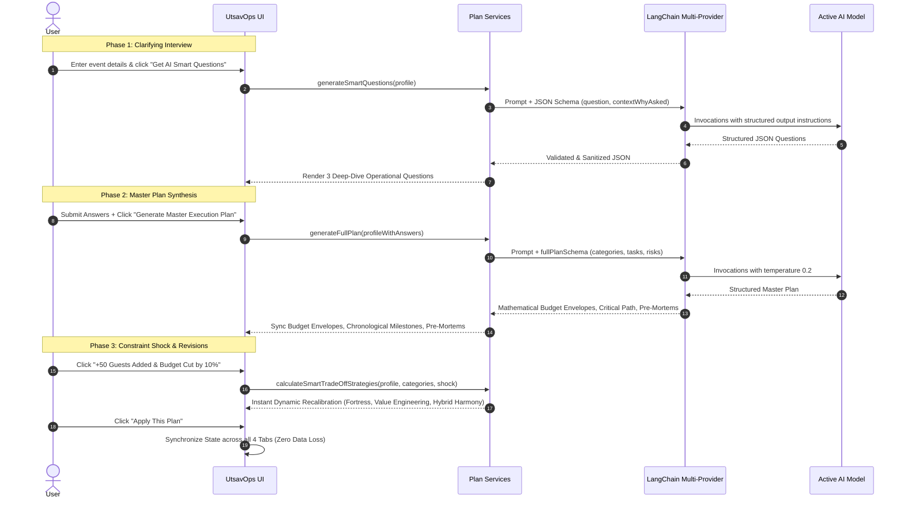

# UtsavOps AI — Celebration & Event Operations Engine
> **PromptWars Challenge 5: Celebration & Event Planner**  
> Built with **React 19**, **TypeScript**, **Vite**, **Tailwind CSS v4**, and **LangChain Multi-Provider BYOK Engine** (OpenRouter, Groq, Google Gemini, OpenAI, xAI Grok, Custom).

---

## 🌟 Executive Summary & Problem Statement Alignment

Organizing large-scale Indian celebrations (Weddings, Milestone Anniversaries, Corporate Galas, Community Utsavs) is fundamentally an exercise in **high-stakes real-time operations under volatility**. Planners face four chronic points of failure:

1. **Rigid Budgeting vs. Real-Life Constraint Shocks**: Spreadsheets break when 50 unannounced guests RSVP or budgets are slashed by 10%. Generic tools start from scratch; **UtsavOps AI dynamically reallocates funds** while fiercely shielding the user's #1 non-negotiable priority (e.g., Catering & Food) with mathematical precision.
2. **Invisible Critical Path Dependencies**: Vendors operate sequentially. If a venue booking is delayed by 7 days, caterers cannot measure kitchens and decorator teams stall. UtsavOps visualizes **topological blockers** (`Blocked by: [Book Venue]`) and provides an **AI Domino Recovery Engine** to recalculate compressed deadlines without schedule drift.
3. **Messy & Deceptive Vendor Quotations**: Indian vendor quotes arrive as messy WhatsApp estimates riddled with sneaky exclusions (e.g., *"18% GST extra"*, *"Generator diesel surcharge ₹8,000"*, *"Staff overtime beyond 11:30 PM"*). UtsavOps extracts normalized unit costs, unmasks hidden taxes, and auto-generates **4 tough WhatsApp negotiation questions**.
4. **Anti-Hallucination Governance & Mathematical Integrity**: Distinguishes unverified AI guestimates from verified vendor quotes with 1-click verification toggles, and guarantees that sum of all allocations across all categories strictly equals the client's total budget.

---

## 🏛 Architecture Diagram & System Design

```mermaid
graph TD
    User([User / Event Planner]) --> Shell[App Shell & HeaderNav]
    Shell --> Context[EventPlanContext Provider]
    Context --> Tab1[Tab 1: Event Setup & Discovery]
    Context --> Tab2[Tab 2: Budget & What-If Simulator]
    Context --> Tab3[Tab 3: Dependency Checklist]
    Context --> Tab4[Tab 4: Compare Vendors]
    
    subgraph UI_Components [Modular UI Tier - WCAG 2.1 AA Compliant]
        Tab1 --> Intake[EventIntakeForm]
        Tab1 --> Ranker[PriorityRanker]
        Tab1 --> SmartQ[SmartQuestionsStep]
        
        Tab2 --> ShockPanel[ConstraintShockPanel]
        Tab2 --> StratCards[TradeOffStrategyCards - React.memo]
        Tab2 --> Charts[BudgetOverviewCharts - Recharts]
        Tab2 --> CatTable[CategoryBreakdownTable - React.memo]
        Tab2 --> CrisisAccordion[CrisisRiskTable - React.memo]
        
        Tab3 --> Toolbar[TimelineToolbar]
        Tab3 --> TaskList[TaskCard - Visual Blockers]
        Tab3 --> DelayModal[DelaySimulationModal]
        
        Tab4 --> QuoteTabs[QuoteInputTabs - Sample Loader]
        Tab4 --> CompareCard[QuoteComparisonCard]
        
        Shell --> ApiModal[ApiKeyModal - BYOK 6 Providers]
        Shell --> NoApiModal[NoApiConfirmModal - Demo Mode]
    end

    subgraph Deterministic_Tier [Deterministic Math & State Engine]
        BudgetLogic[src/utils/budgetLogic.ts]
        TradeoffLogic[src/utils/tradeoffLogic.ts]
        BudgetWeights[src/constants/budgetWeights.ts]
        BudgetLogic --> MathCheck[Exact Budget Reconciliation Math]
        BudgetLogic --> DepCheck[Topological Dependency Resolver]
        StateStore[Unified React State - Zero Data Loss Sync]
    end

    subgraph AI_Tier [LangChain Multi-Provider & BYOK Engine]
        LangChainClient[src/services/langchainClient.ts]
        PlanService[src/services/fullPlanService.ts]
        BudgetPlanService[src/services/budgetPlanService.ts]
        TimelineService[src/services/timelineService.ts]
        CrisisService[src/services/crisisService.ts]
        QuestionsService[src/services/smartQuestionsService.ts]
        DemoPlanService[src/services/smartDemoService.ts]
        QuoteService[src/services/quoteService.ts]
    end

    UI_Components --> BudgetLogic
    UI_Components --> TradeoffLogic
    UI_Components --> StateStore
    UI_Components --> LangChainClient
    LangChainClient --> OpenRouter[OpenRouter openrouter/free]
    LangChainClient --> Groq[Groq Llama 3.3 70B]
    LangChainClient --> Gemini[Google Gemini 2.5 Flash]
    LangChainClient --> OpenAI[OpenAI GPT-4o-mini]
    LangChainClient --> Grok[xAI Grok-2]
    LangChainClient --> Custom[Custom OpenAI-Compatible API]
```



---

## 🔄 AI Prompt Flow & Structured Schemas



---

## ⚖️ Division of Labor: GenAI vs. Deterministic Logic

| Responsibility | Handled By | Rationale |
| :--- | :--- | :--- |
| **Topological Blocked Badges** | **Deterministic Logic** (`src/utils/budgetLogic.ts`) | Strict graph resolution ensures downstream tasks are never falsely unlocked until parent IDs reach `status === 'completed'`. |
| **Budget Mathematical Integrity** | **Deterministic Logic** (`src/constants/budgetWeights.ts`) | Enforces sum(allocatedAmount) === totalBudget to eliminate floating-point rounding drifts and LLM arithmetic errors. |
| **Dynamic Trade-Off Formulations** | **Deterministic Domain Engine** (`src/utils/tradeoffLogic.ts`) | Scaled to actual budget (₹10k to ₹80L+) with 100% protection of client's #1 non-negotiable priority. |
| **Date Arithmetic & Milestone Shifts** | **Deterministic Logic** (`Date.getTime() + delta`) | Guaranteed non-drift calendar day shifts without hallucinating invalid dates. |
| **State Synchronization across Tabs** | **React Context API** (`src/context/EventPlanContext.tsx`) | Single source of truth; applying a revision instantly updates Header pills, Recharts, and task lists without wiping data. |
| **Smart Clarifying Questions** | **LangChain / LLM** (`smartQuestionsService.ts`) | Natural language synthesis to formulate hyper-contextual questions based on guest age mix and atmosphere. |
| **Vendor Quote OCR & Hidden Levy Audit** | **LangChain / LLM** (`quoteService.ts`) | Parses unstructured, messy WhatsApp chats to unmask hidden GST, generator fuel, and overtime penalties. |
| **Tough WhatsApp Negotiation Scripts** | **LangChain / LLM** (`quoteService.ts`) | Crafts professional, culturally attuned, assertive negotiation prompts ready for WhatsApp copy-pasting. |

---

## 📦 Core Feature Modules

### 🎯 Tab 1: Event Setup & Discovery
- **Multi-Occasion Intake**: Fast presets for Weddings, Birthdays, Cultural/Community Events, and Corporate Galas with input length validation.
- **Atmosphere Selector**: Visual selection across *Intimate*, *Balanced*, and *Grand* celebrations.
- **Priority Ranker**: Drag-and-drop / Move Up & Down reordering of core pillars (Food & Catering, Venue, Decor, Photography, Entertainment).
- **AI Clarifying Questions**: Formulates 3 operational questions (e.g. monsoon backup, Jain counters, senior-citizen wheelchair ramps) before finalizing the plan.

### 💰 Tab 2: Budget & What-If Simulator
- **Constraint Shock & Revision Panel**: Instant test triggers for judges:
  - **Button A**: `+50 Guests Added & Budget Cut by 10%`
  - **Button B**: `Expenses Exceeded Budget by 20% (₹8L -> ₹9.6L)`
  - **Button C**: `Event Moved 2 Weeks Earlier`
  - **Custom Prompt**: Type any natural language scenario.
- **3 Distinct Trade-Off Strategies**:
  1. *Priority-Shielding / The Fortress*: 100% protection for the #1 ranked category.
  2. *Per-Unit Value Engineering*: Live counters and per-plate menu re-engineering.
  3. *Hybrid Harmony*: Balanced, proportional trims across all discretionary vendors.
- **Anti-Hallucination Governance**: One-click toggles between `AI Estimate (Unverified)` and `Confirmed Vendor Quote`.
- **Recharts Data Visualizations**: Donut allocation chart with color-matched legends and safety buffer indicators.

### 📅 Tab 3: Dependency Checklist
- **Sorting & Filtering**: Multi-dimensional filtering by Category, Status (`pending`, `completed`, `delayed`), and Priority (`High`, `Medium`, `Low`).
- **Visual Dependency Tracking**: Downstream tasks show an animated lock badge: `Blocked by: [Parent Milestone]` until parent tasks are completed.
- **Simulate Delay / Bottleneck Action**:
  - Select `+3`, `+7`, or `+14` days late on critical milestones.
  - LLM analyzes cascading domino effects and generates a 4-point **AI Recovery Action Plan**.
  - One-click application shifts downstream deadlines and logs recovery adjustments.

### 🔍 Tab 4: Compare Vendors
- **Multi-Vendor Procurement Audit**: Paste 1–3 unstructured quotes, contracts, or WhatsApp estimates.
- **1-Click Sample Catering Quotes**: Loads authentic Indian wedding catering proposals (*Royal Rasoi Banquets & Catering* vs. *Grand Annapurna Gourmet Caterers*) for instant testing.
- **Side-by-Side Comparison Matrix**:
  - Base cost, per-plate/unit cost, and guest capacity.
  - Automatic detection of **Hidden Surcharges & Exclusions** (18% GST, generator fuel fees, bone china cutlery handling, and late-night overtime fees).
  - Budget alignment against allocated category envelope.
  - **4 Tough WhatsApp Questions**: Assertive clarification questions with a 1-click **"Copy for WhatsApp"** button.

---

## 🛡️ Code Quality, Security & Accessibility (WCAG 2.1 AA)

- **Strict TypeScript**: Clean compilation with `"strict": true`, `"noImplicitReturns": true`, and `"forceConsistentCasingInFileNames": true` across 100% of files.
- **Modular Architecture**: File length strictly controlled. `planService.ts` refactored into 6 single-responsibility modules (`budgetPlanService.ts`, `timelineService.ts`, `crisisService.ts`, `smartQuestionsService.ts`, `smartDemoService.ts`, `fullPlanService.ts`).
- **No Prop Drilling**: Global state shared via `EventPlanContext` with typed hooks and zero duplicate renders.
- **Component Memoization**: Pure presentational components (`CategoryBreakdownTable`, `TradeOffStrategyCards`, `CrisisRiskTable`, `BudgetOverviewCharts`, `LoadingSkeleton`, `ErrorRetryAlert`, `HeaderNav`) optimized with `React.memo` and explicit `displayName`.
- **Accessibility Enhancements**:
  - **WCAG Skip Link**: `Skip to main content` button for keyboard users.
  - **Focus Trapping**: Automated tab key cycle trapping on `ApiKeyModal` and `NoApiConfirmModal`.
  - **Escape Key Close**: Immediate dialog closing via standard Escape key.
  - **WAI-ARIA Radio Group Semantics**: Provider selection buttons with `role="radio"` and `aria-checked`.
  - **Live Announcements**: `aria-live="polite"` and `aria-atomic="true"` on dynamic toast notifications.
  - **Arrow Key Tab Navigation**: Keyboard navigation between tabs using ArrowLeft and ArrowRight.
- **Security & Key Isolation**:
  - Content Security Policy (CSP) meta tags enforced in `index.html`.
  - `rel="noopener noreferrer"` on all external links.
  - `maxLength` limits on all free-text input fields to prevent prompt-injection buffer attacks.
  - User API keys stored exclusively in browser `sessionStorage` (never sent to external servers or logged).

---

## 🧪 Testing Suite (74 Automated Tests)

Automated unit & integration tests powered by **Vitest** verify core mathematical calculations, pipeline integrity, edge cases, and provider validation:

```bash
npm test
```

### Verified Test Suites (11 files, 74 passing tests):
- [x] `fullPlanPipeline.test.ts`: Complete master plan generation, mathematical integrity sum, priority shielding, and critical-path validation.
- [x] `edgeCases.test.ts`: Zero guests, zero budget floor, empty priority arrays, invalid dates, and budget variance calculations.
- [x] `jsonExtraction.test.ts`: Stripping `<think>` reasoning tags, markdown code blocks, outermost brace recovery, and trailing comma repair.
- [x] `providerValidation.test.ts`: Key format and prefix validation for OpenRouter, Groq, Google Gemini, OpenAI, xAI Grok, and Custom endpoints.
- [x] `errorFallback.test.ts`: Graceful API error recovery, default fallback questions, and offline demo mode execution.
- [x] `budgetLogic.test.ts`: Per-guest calculations, variance, unadjusted item preservation, and topological blockers.
- [x] `tradeoffLogic.test.ts`: Calibrated dynamic trade-off math for small events (₹10k) and luxury weddings (₹80L).
- [x] `smartDemoPlan.test.ts`: Comprehensive offline plan generation and envelope weighting.
- [x] `errorRetry.test.ts`: Diagnostic classification and user retry actions.
- [x] `priorityLogic.test.ts`: Dynamic priority weighting and reordering.
- [x] `modelSelection.test.ts`: Active provider resolution and model persistence.

---

## 🚀 Setup & Execution Guide

### Prerequisites
- Node.js 18+ (tested on Node 20 / 22)
- npm or pnpm

### 1. Installation
```bash
# Clone the repository and navigate to the project directory
cd "challenge 5"

# Install dependencies
npm install
```

### 2. Run Development Server
```bash
npm run dev
```
Open [http://localhost:5173/](http://localhost:5173/) in your browser.

### 3. Run Unit Tests & Lint
```bash
# Run 74 unit tests
npm test

# Check TypeScript types
npx tsc -b

# Build production bundle with optimized rollup chunks
npm run build
```

---

## 📄 License & Attribution
Designed and built for **PromptWars Challenge 5: Celebration & Event Planner**.  
Powered by LangChain multi-provider engine (OpenRouter, Groq, Google Gemini, OpenAI, xAI Grok).
